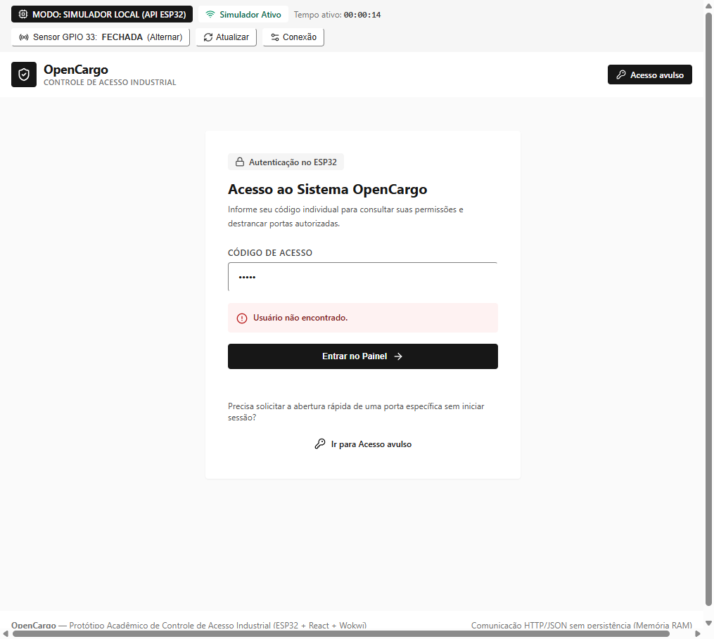
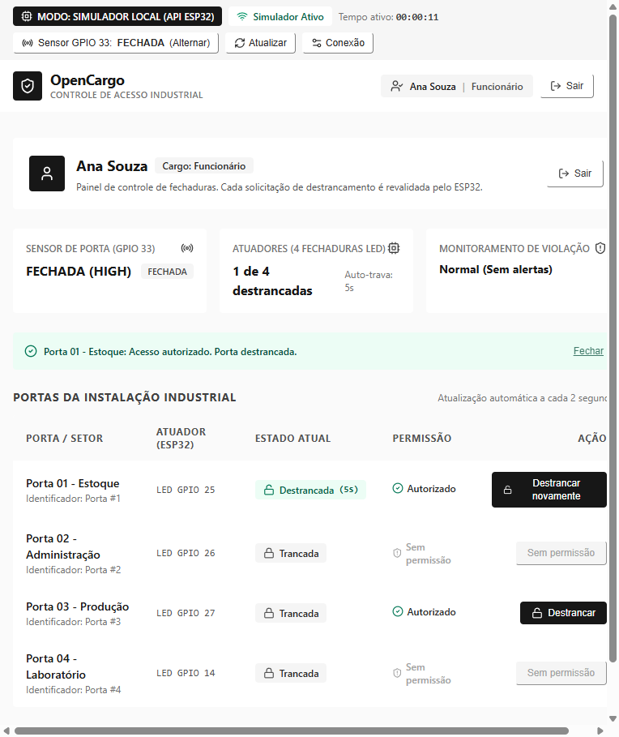
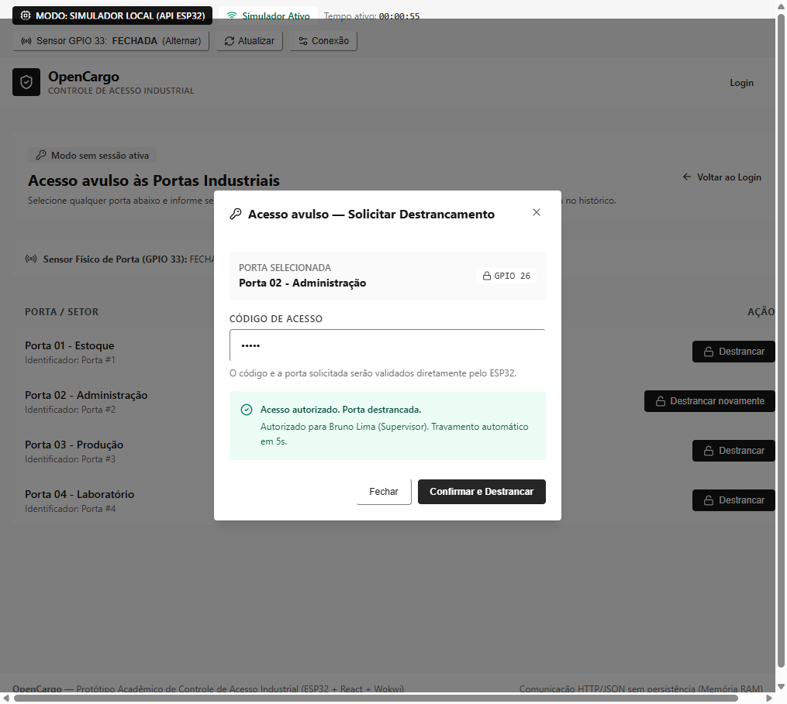
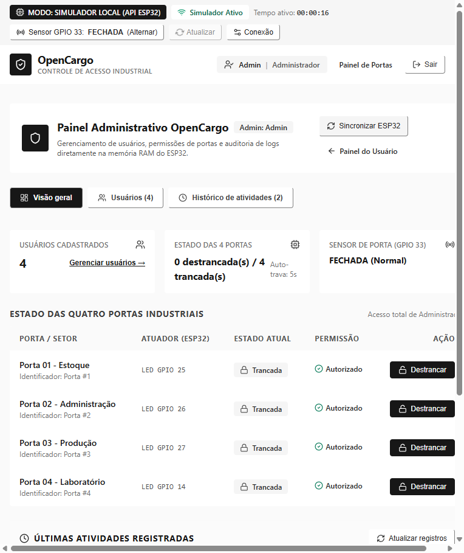
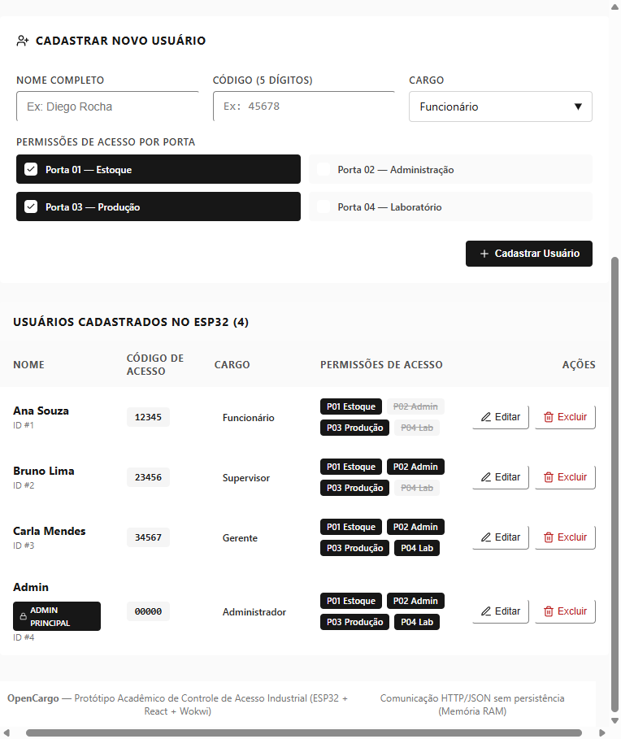
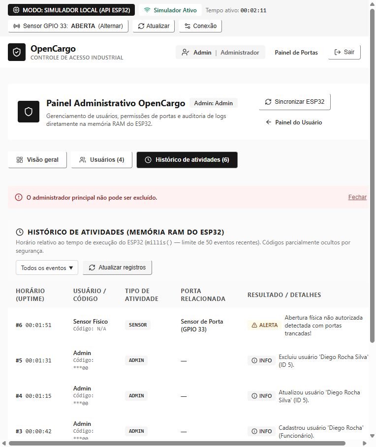
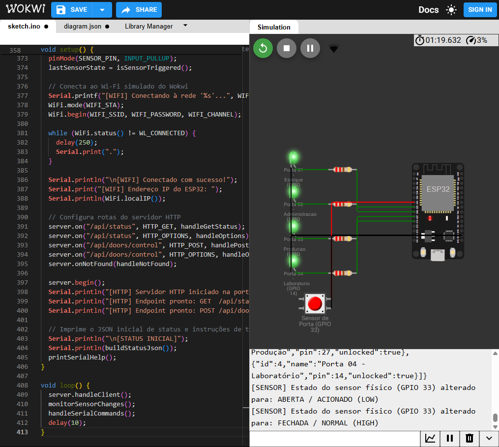

# OpenCargo

**OpenCargo** é um sistema de controle de acesso industrial baseado em Internet das Coisas (IoT), desenvolvido para monitorar e gerenciar o acesso de funcionários a diferentes setores de uma instalação industrial. Utilizando um ESP32 conectado à rede Wi-Fi, o sistema valida permissões de usuários, controla fechaduras eletrônicas, monitora eventos por sensores e disponibiliza uma interface web para gerenciamento e acompanhamento das atividades.

---

## Stack

- **Microcontrolador:** ESP32 (C++ / Arduino Core — `WiFi.h`, `WebServer.h`)
- **Simulação de Hardware:** Wokwi (4 LEDs de fechaduras + Sensor digital de porta no `GPIO 33`)
- **Frontend:** React, Vite, JavaScript, UnoCSS, React Router e Lucide React
- **Comunicação:** HTTP + JSON (Memória RAM)

---

## Usuários e Permissões Iniciais

| Usuário | Código | Cargo | Portas Liberadas |
| :--- | :---: | :--- | :--- |
| **Ana Souza** | `12345` | Funcionário | Porta 01 (Estoque) e Porta 03 (Produção) |
| **Bruno Lima** | `23456` | Supervisor | Porta 01, Porta 02 (Administração) e Porta 03 |
| **Carla Mendes** | `34567` | Gerente | Todas as portas (01 a 04 — inclui Laboratório) |
| **Admin** | `00000` | Administrador | Todas as portas + Painel Administrativo (`/admin`) |

---

## Telas do Sistema

### 1. Login (`/`)


### 2. Painel do Usuário (`/dashboard`)


### 3. Acesso Avulso (`/access`)


### 4. Painel Administrativo — Visão Geral (`/admin`)


### 5. Painel Administrativo — Gerenciamento de Usuários (`/admin`)


### 6. Painel Administrativo — Histórico de Atividades (`/admin`)


### 7. Simulação do Circuito no Wokwi (ESP32)


---

## Instalação e Uso

### 1. Frontend (React)

```bash
cd frontend
npm install
npm run dev
```

Acesse **`http://localhost:5173/`**.  
*(Caso esteja testando sem gateway local do Wokwi, clique em **"Usar Simulador Local"** na barra superior).*

### 2. Firmware e Circuito (Wokwi)

1. Acesse [wokwi.com/projects/new/esp32](https://wokwi.com/projects/new/esp32).
2. Cole o conteúdo de [`firmware/sketch.ino`](./firmware/sketch.ino) na aba `sketch.ino` e [`firmware/diagram.json`](./firmware/diagram.json) na aba `diagram.json`.
3. Inicie a simulação (**Start the simulation**).
4. No Monitor Serial, digite `test` para executar o autoteste completo da API HTTP na porta 80 e acionar os 4 LEDs.

---

## Documentação Adicional

- [Arquitetura e Pinagem](./docs/ARCHITECTURE.md)
- [Referência da API HTTP](./docs/API.md)
- [Relatório de Testes](./docs/TESTING.md)
- [Roteiro de Apresentação](./docs/PRESENTATION.md)
- [Checklist de Requisitos](./docs/REQUIREMENTS_CHECKLIST.md)
