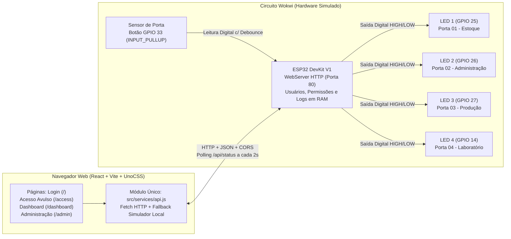

# Arquitetura do Sistema — OpenCargo

Este documento descreve a arquitetura técnica, a divisão de responsabilidades entre o frontend React e o firmware ESP32, o mapa de pinos do circuito no Wokwi e os fluxos de operação manual e automática.

---

## 1. Visão Geral da Arquitetura

O **OpenCargo** segue uma arquitetura cliente-servidor enxuta de duas camadas, sem servidores intermediários (sem Node.js, Flask ou banco de dados externo). O próprio **ESP32** hospeda o servidor HTTP e executa todas as regras de negócio:

---

## 2. Divisão de Responsabilidades (Frontend vs. Firmware)

| Camada | Responsabilidades | O que NÃO faz |
| :--- | :--- | :--- |
| **Firmware ESP32** ([`firmware/sketch.ino`](../firmware/sketch.ino)) | • Conectar ao Wi-Fi (`Wokwi-GUEST`) e expor o servidor HTTP na porta 80. • Manter em RAM a lista de usuários, cargos, permissões por porta e os últimos 50 logs. • Validar códigos de acesso em **todas** as operações (`/api/login`, `/api/access`, `/api/users`, `/api/logs`). • Acionar os 4 LEDs das fechaduras e controlar o temporizador de travamento automático (5 segundos). • Monitorar continuamente o sensor físico (`GPIO 33`) e disparar alertas de violação. | • Não renderiza HTML/CSS pesado. • Não confia em permissões ou cargos informados pelo frontend. |
| **Frontend React** ([`frontend/src/`](../frontend/src/)) | • Apresentar interface limpa em preto e branco para Login, Acesso Avulso, Painel do Usuário e Administração. • Consultar periodicamente `GET /api/status` (a cada 2s) para exibir o estado real das portas e do sensor. • Enviar comandos HTTP (`POST`, `PUT`, `DELETE`) centralizados em [`frontend/src/services/api.js`](../frontend/src/services/api.js). • Exibir mensagens claras de erro, permissão negada ou desconexão do ESP32. | • **Nunca** decide sozinho se um código é válido ou se um usuário tem permissão para abrir uma porta. • Não armazena senhas de outros usuários. |

---

## 3. Comunicação entre React e ESP32

1. **Protocolo e Formato:**
   - Requisições HTTP diretas do navegador para o endereço configurado em `VITE_ESP32_BASE_URL` (padrão `http://localhost:8180`, correspondente ao encaminhamento definido em [`firmware/wokwi.toml`](../firmware/wokwi.toml)).
   - Todas as respostas utilizam `Content-Type: application/json; charset=utf-8`.
2. **CORS (Cross-Origin Resource Sharing):**
   - Como o servidor de desenvolvimento Vite roda em `http://localhost:5173` e o ESP32 em outra origem/porta, o firmware envia os cabeçalhos `Access-Control-Allow-Origin: *`, `Access-Control-Allow-Methods: GET, POST, PUT, DELETE, OPTIONS` e `Access-Control-Allow-Headers: Content-Type, X-Access-Code`, respondendo com `HTTP 204` às requisições preflight `OPTIONS`.
3. **Estratégia de Atualização (Polling HTTP):**
   - O componente [`frontend/src/App.jsx`](../frontend/src/App.jsx) consulta `GET /api/status` ao iniciar, a cada **2 segundos** (com proteção `isFetchingRef` contra empilhamento de requisições em caso de lentidão/desconexão) e imediatamente após qualquer ação de destrancamento.
   - O componente também monitora o campo `uptimeMs` retornado pelo ESP32: se `uptimeMs` cair para um valor menor que o da leitura anterior, o frontend detecta que o ESP32 foi reiniciado e exibe um aviso informando que os dados voláteis em RAM foram restaurados.
4. **Modo Simulador Local da API (Fallback para Wokwi Web Gratuito):**
   - Como o Wokwi Web gratuito (`Public IoT Gateway`) bloqueia conexões HTTP de entrada vindas do navegador local, o módulo [`frontend/src/services/api.js`](../frontend/src/services/api.js) inclui um espelho fiel da API do ESP32.
   - Esse modo fica desligado por padrão (o sistema inicia em `MODO: ESP32 REAL`) e, quando ativado pelo usuário, exibe um badge preto destacado no topo de todas as telas: **`MODO: SIMULADOR LOCAL (API ESP32)`**.

---

## 4. Fluxo de Autenticação e Autorização

1. **Login (`POST /api/login`):**
   - O usuário digita seu código de 5 dígitos em `/`.
   - O React envia `{ "code": "12345" }` ao ESP32.
   - O ESP32 procura o código no array `users[]` em RAM, registra a tentativa (`AUTORIZADO` ou `NEGADO`) no histórico com o código mascarado (`***45`) e retorna os dados públicos do usuário (`id`, `name`, `role`, `isAdmin`, `permissions`).
2. **Solicitação de Acesso no Painel ou Acesso Avulso (`POST /api/access`):**
   - Ao clicar em **Destrancar** (seja no `/dashboard` ou no modal de `/access`), o React envia `{ "code": "<codigo>", "doorId": <1..4>, "mode": "panel" | "single" }`.
   - O ESP32 valida novamente:
     - Se a porta não existir (fora de 1..4) → `HTTP 404 (INVALID_DOOR)`.
     - Se o código não existir → registra log `NEGADO` e retorna `HTTP 401 (USER_NOT_FOUND)`.
     - Se o usuário não tiver permissão para aquela porta → registra log `NEGADO` e retorna `HTTP 403 (FORBIDDEN)`.
     - Se autorizado → aciona o pino do LED correspondente (`HIGH`), inicia o cronômetro de 5 segundos, registra log `AUTORIZADO` e retorna `HTTP 200`.
3. **Operações Administrativas (`/api/users` e `/api/logs`):**
   - Toda requisição administrativa exige o código do administrador (`adminCode` via query string `?adminCode=00000`, cabeçalho `X-Access-Code` ou corpo JSON).
   - O ESP32 verifica se o código pertence a um usuário ativo com cargo `"Administrador"`. Caso contrário, nega a operação com `HTTP 403 (ADMIN_REQUIRED)`.

---

## 5. Sensores, Atuadores e Pinagem do ESP32

O circuito definido em [`firmware/diagram.json`](../firmware/diagram.json) utiliza o **ESP32 DevKit V1** com a seguinte pinagem:

| Componente no Wokwi | ID no Diagrama | Papel no Sistema | Pino ESP32 | Configuração Elétrica |
| :--- | :---: | :--- | :---: | :--- |
| **LED Verde 1** + Resistor 220 Ω | `led1` / `r1` | Atuador — Fechadura **Porta 01 (Estoque)** | `GPIO 25` (`D25`) | Saída Digital (`HIGH` = Destrancada / `LOW` = Trancada) |
| **LED Verde 2** + Resistor 220 Ω | `led2` / `r2` | Atuador — Fechadura **Porta 02 (Administração)** | `GPIO 26` (`D26`) | Saída Digital (`HIGH` = Destrancada / `LOW` = Trancada) |
| **LED Verde 3** + Resistor 220 Ω | `led3` / `r3` | Atuador — Fechadura **Porta 03 (Produção)** | `GPIO 27` (`D27`) | Saída Digital (`HIGH` = Destrancada / `LOW` = Trancada) |
| **LED Verde 4** + Resistor 220 Ω | `led4` / `r4` | Atuador — Fechadura **Porta 04 (Laboratório)** | `GPIO 14` (`D14`) | Saída Digital (`HIGH` = Destrancada / `LOW` = Trancada) |
| **Botão Vermelho (Pushbutton)** | `btnSensor` | Sensor Digital — **Abertura Física / Violação de Porta** | `GPIO 33` (`D33`) | Entrada com `INPUT_PULLUP` (`HIGH` = Fechada / `LOW` = Aberta) |

---

## 6. Funcionamento Automático vs. Funcionamento Manual

Para atender integralmente aos requisitos acadêmicos do Projeto Integrador de IoT:

### 6.1 Funcionamento Manual (Acionamento pelo Usuário via Interface Web)
- **Destrancamento de Portas:** O usuário autenticado no `/dashboard` (ou qualquer funcionário via modal em `/access`) clica no botão **Destrancar** de uma porta. Após validar a permissão, o ESP32 acende imediatamente o LED daquela fechadura.
- **Reconhecimento de Alerta de Sensor:** Quando há um alerta de violação ativo no painel, o operador ou administrador pode clicar no botão **Reconhecer** (`POST /api/sensor/ack`) para redefinir o estado de alarme após verificar a ocorrência.

### 6.2 Funcionamento Automático (Lógica Autônoma do ESP32)
1. **Resposta Automática ao Sensor Físico (`monitorSensorChanges()`):**
   - O ESP32 lê continuamente o pino `GPIO 33` com filtro de debounce de `40 ms`.
   - Se o sensor for acionado (`LOW` — porta física aberta) em um momento em que **todas as 4 fechaduras estão trancadas**, o ESP32 identifica automaticamente uma **abertura física não autorizada**, ativa o sinalizador `sensorAlertActive = true` (exibido em vermelho na interface web como **`VIOLAÇÃO DETECTADA!`**) e grava automaticamente um evento de `ALERTA` no histórico.
   - Se o sensor for acionado enquanto uma porta estiver legitimamente destrancada, o ESP32 registra apenas um evento informativo (`INFO`) de passagem durante acesso autorizado.
2. **Travamento Automático Temporizado (`updateDoorAutoLockTimers()`):**
   - Nenhuma porta destrancada via `/api/access` permanece aberta indefinidamente.
   - O loop principal do ESP32 monitora o tempo decorrido desde o destrancamento (`millis() - door.unlockedAtMs`). Ao atingir `DOOR_UNLOCK_DURATION_MS` (`5000 ms`), o ESP32 apaga o LED automaticamente (`LOW`), altera o estado da porta para `unlocked = false` e grava um registro `TRAVAMENTO_AUTO` no histórico.
